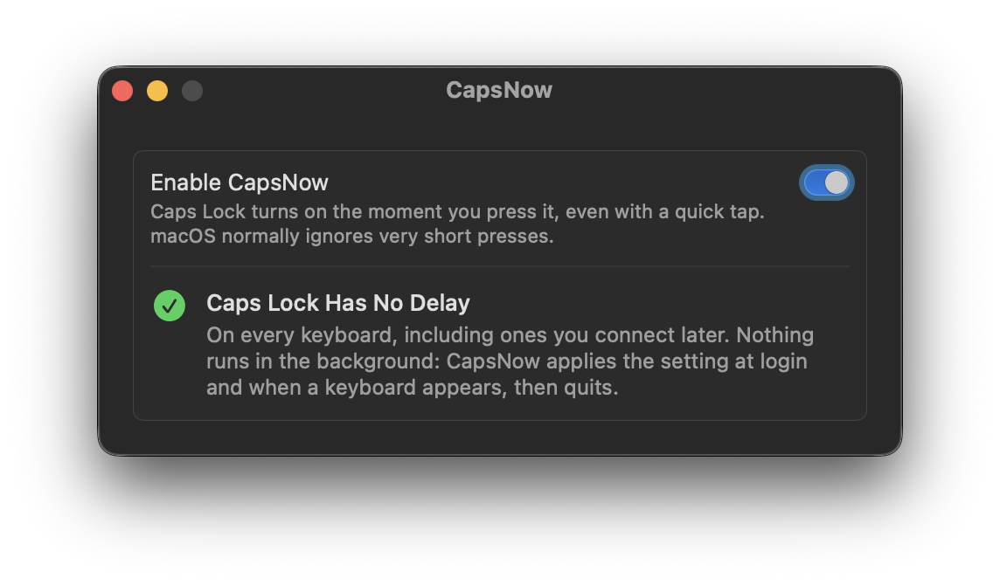

# CapsNow

**Caps Lock without the delay.**

<p align="center">
  
</p>

macOS ignores a Caps Lock press shorter than 75 milliseconds, on purpose, so that Caps Lock does not turn on by
accident. The price is that quick taps get lost: you tap Caps Lock, keep typing, and the letters come out in the
wrong case. CapsNow turns that delay off, so a quick tap is enough.

## Nothing running

macOS already has a setting for this delay. It just isn't in System Settings, and it resets at every restart.
CapsNow's helper sets it at login and whenever a keyboard appears, then quits, so the rest of the time CapsNow uses
no memory and no CPU at all. There is no menu bar icon and no permission to grant. The app is about 1 MB.

## Features

- Works on every keyboard (built-in, USB and Bluetooth), including ones you connect or reconnect later
- Turning it off gives macOS its own delay back right away

## Requirements

- A Mac with Apple silicon
- macOS 13 Ventura or later

Tested on a 14-inch MacBook Pro (Apple silicon) with macOS 26.7.1 Tahoe, with the built-in keyboard and a
Bluetooth keyboard.

## Install

### Homebrew

```sh
brew install --cask fratayaydn/tap/capsnow
```

### Download

Download `CapsNow-<version>.dmg` from the [latest release](https://github.com/fratayaydn/capsnow/releases/latest),
open it and drag **CapsNow** to **Applications**. The app is signed with a Developer ID and notarized by Apple.

### First run

Open **CapsNow** and turn on **Enable CapsNow**. You can close the window right after; nothing has to stay open.

## How it works

- macOS's keyboard filter delays Caps Lock by the keyboard's own delay (75 ms on Apple keyboards) unless the HID
  property `CapsLockDelayOverride` says otherwise. CapsNow sets it to 0 through the public
  `IOHIDEventSystemClient` API, the same setting `hidutil property --set '{"CapsLockDelayOverride":0}'` changes.
- `CapsNow.app/Contents/MacOS/capsnowd` is registered as a login item through `SMAppService`, but it is not a
  background process: its launchd job has no `KeepAlive`. launchd runs it at login and on an IOKit "keyboard
  appeared" event, it sets the property and quits within two seconds.
- Turning CapsNow off sets the property back to -1, the value macOS starts with, which means "no override".
- `CapsNow.app/Contents/MacOS/CapsNow` is the SwiftUI settings window. It runs only while open.

CapsNow uses only public macOS APIs.

## Building from source

Requires the Xcode Command Line Tools (`xcode-select --install`).

```sh
git clone https://github.com/fratayaydn/capsnow.git
cd capsnow
make install
```

This builds `CapsNow.app`, copies it to `/Applications` and opens it. To update, pull and run `make install` again.

Local builds are signed with a self-signed certificate that `scripts/create-signing-identity.sh` creates on the
first build, so the login item keeps working across rebuilds; `scripts/install.sh` re-registers it after each
update. To sign with your own Apple Developer ID instead:
`make install SIGN_IDENTITY="Developer ID Application: Your Name (TEAMID)"`.

## Uninstall

Turn off **Enable CapsNow**, then move **CapsNow** to the Trash (or `brew uninstall --cask capsnow`).

If you move it to the Trash without turning it off first, the delay stays off until the next restart, and then
macOS's own delay is back: the setting never survives a restart on its own. Since CapsNow does not run in the
background, it cannot notice being removed.

To remove the settings too, use `brew uninstall --zap --cask capsnow` instead, or run
`defaults delete io.github.fratayaydn.capsnow` after moving the app to the Trash. If you built it from source,
`make uninstall` in the cloned folder removes both the app and the settings.

## Command line

```sh
/Applications/CapsNow.app/Contents/MacOS/capsnowd --status   # prints the current Caps Lock delay
/Applications/CapsNow.app/Contents/MacOS/capsnowd --off      # gives macOS its own delay back
```

## More small Mac apps

- [NightKeys](https://github.com/fratayaydn/nightkeys): keyboard backlight that only comes on when you type on the
  built-in keyboard
- [BalanceKeeper](https://github.com/fratayaydn/balancekeeper): puts the left/right audio balance back when macOS
  shifts it
- [MicKeeper](https://github.com/fratayaydn/mickeeper): keeps AirPods and iPhones off the microphone, so AirPods don't
  drop to call quality
- [FullscreenKeeper](https://github.com/fratayaydn/fullscreenkeeper): reopens apps in full screen if you quit them in
  full screen

## License

MIT license, see [LICENSE](LICENSE).
